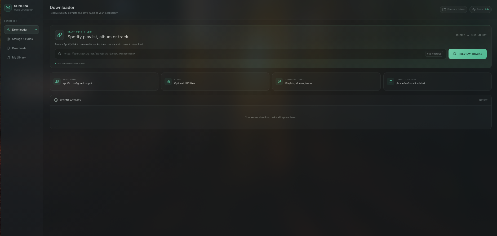
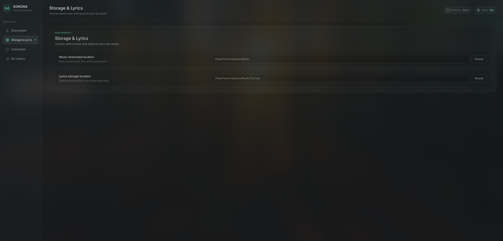
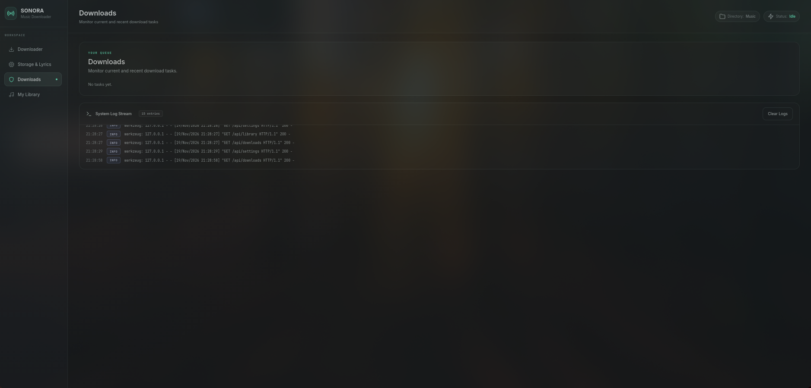
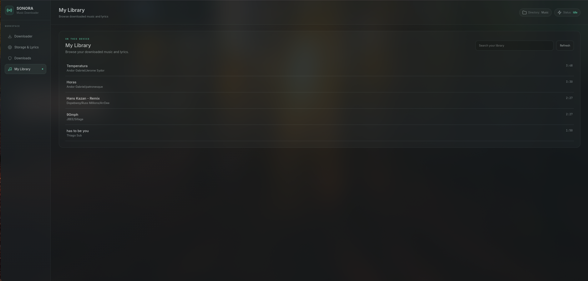

<div align="center">

# 🎧 SONORA

**Turn Spotify links into a music library you own.**
Preview playlists, albums and tracks, pick what you want, and save it to your own computer.




</div>

## ✨ Features

- 🔗 **Paste and preview**: drop in a Spotify playlist, album or track link and see its tracks first
- ✅ **Download only what you want**: select individual tracks before starting
- 📁 **Your folders, your rules**: pick music and lyrics locations with a native folder picker
- 📝 **Optional `.LRC` lyrics**: saved separately when lyrics are available on the track
- 📊 **Live download queue** with a built-in system log stream
- 🎵 **Built-in library browser** with search for everything you have downloaded
- 🔒 **100% local**: no accounts, no cloud, everything stays on your machine

## 🖼️ Screenshots

| 📥 Downloader | ⚙️ Storage & Lyrics |
|:---:|:---:|
|  |  |
| **⏬ Downloads** | **🎵 My Library** |
|  |  |

## 📦 Requirements

- 🐍 Python 3.10+
- 🎬 [FFmpeg](https://ffmpeg.org/) on your `PATH`
- 🖱️ Tkinter for the folder picker (Debian/Ubuntu: `sudo apt install python3-tk`)

## 🚀 Setup

```bash
git clone https://github.com/dridimouath-rgb/Sonar.git
cd Sonar
python -m venv .venv

# Linux / macOS
source .venv/bin/activate
# Windows (PowerShell)
.venv\Scripts\Activate.ps1

pip install -r requirements.txt
cp .env.example .env
```

## ▶️ Usage

```bash
python app.py
```

Then open <http://127.0.0.1:5000> and:

1. 📁 Choose your music (and optional lyrics) folders in **Storage & Lyrics**
2. 🔗 Paste a Spotify link in **Downloader** and click **Preview Tracks**
3. ✅ Select the tracks you want and start the download
4. 🎶 Find them later in **My Library**

Settings and task state are saved in `instance/`, and logs in `logs/` (both git-ignored).

## 🧪 Tests

```bash
python -m unittest discover -s tests -v
```

## ⚠️ Notes

- 🏠 Local use only. Exposing the server to the public internet is not supported.
- ⚖️ Use SONORA in compliance with copyright law and the terms of the services you use.
- 📝 Lyrics are saved only when already present on a track object. SONORA has no Spotify lyrics access.

## 📄 License

Released under the [MIT License](LICENSE).
